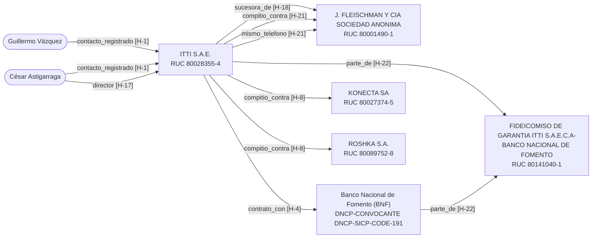

# Ficha de due diligence: Itti S.A.E. (Paraguay)

Caso 1 · creado 2026-10-24T00:12:50+00:00 · generado 2026-10-24T00:22:48+00:00 · modo real · criterio ejemplo-0.1 (SHA-256 251e79b1eb3d…)

> Documento interno de trabajo. Solo afirma lo que dice cada fuente, con la etapa de cada caso judicial. El semáforo es una sugerencia; la conclusión la firma una persona. El proveedor debe poder responder antes de una decisión que lo afecte.

> ⚠ El criterio de semáforo es el EJEMPLO del documento de diseño: la UNI debe reemplazarlo antes de usar el sistema.

## Semáforo sugerido

**Color sugerido: ROJO** · puntaje P = 9.6 (color por puntaje: rojo; reglas duras activadas: 0)

| Hallazgo | Tipo | Regla / categoría | Dato | Aporte |
|---|---|---|---|---|
| [H-18](https://www.contrataciones.gov.py/datos/api/v3/doc/suppliers/80001490-1) | hecho | sancion_dncp_historica | J. FLEISCHMAN SAECA (RUC 80001490-1) registrada en la DNCP como 'absorbido por ITTI S.A.E.C.A', con una amonestación desde el 18/01/2023 | 2 × 1 = 2 |
| [H-21](https://www.contrataciones.gov.py/datos/api/v3/doc/ocds/record/ocds-03ad3f-403937-1) | hecho | llave_compartida_competidor | En 3 procesos del BNF de 2022 los únicos dos oferentes fueron ITTI S.A.E. y J. Fleischman (registrada como absorbida por ITTI), que comparten teléfono | 2 × 1 = 2 |
| [H-4](https://www.contrataciones.gov.py/datos/api/v3/doc/search/processes?awards.suppliers.id=80028355-4&page=1&items_per_page=10) | hecho | indicador_ocds_bandera_roja | Concentración: 10 de 34 procesos adjudicados son del Banco Nacional de Fomento (29 %) | 1 × 1 = 1 |
| [H-5](https://www.contrataciones.gov.py/datos/api/v3/doc/ocds/record/ocds-03ad3f-411587-1) | hecho | indicador_ocds_bandera_roja | Oferente único en la LPN 411587 del BNF (software de gestión de riesgos), adjudicada por 3.200.000.000 PYG | 1 × 1 = 1 |
| [H-6](https://www.contrataciones.gov.py/datos/api/v3/doc/ocds/record/ocds-03ad3f-467133-1) | hecho | indicador_ocds_bandera_roja | Subasta 467133 del BNF: único oferente y adjudicación 18,6 % por encima del monto estimado | 1 × 1 = 1 |
| [H-9](https://www.contrataciones.gov.py/datos/api/v3/doc/complaints/1103) | hecho | protesta_o_reclamo | Protesta 1103 de ROSHKA S.A. contra la adjudicación a ITTI del proceso 428009 (BNF): rechazada in límine (Res. DNCP 4786/23) | 1 × 1 = 1 |
| [H-12](https://www.abc.com.py/economia/2025/05/11/itti-habria-incumplido-un-requisito-sustancial-en-la-licitacion-del-bnf/) | posible_alerta | prensa_negativa | Según ABC Color, en el llamado 445258 ITTI no presentó el formulario de oferta firmado; el BNF declaró desierto el llamado | 1 × 0.4 = 0.4 |
| [H-13](https://prensamercosur.org/2025/12/09/al-menos-cinco-articulos-se-violaron-en-licitacion-del-bnf-segun-denuncia/) | posible_alerta | prensa_negativa | Según la prensa, el Consorcio Solubank denunció ante la DNCP irregularidades en la evaluación de ITTI en el llamado 445258 (denuncia pendiente a dic. 2025) | 1 × 0.4 = 0.4 |
| [H-14](https://www.abc.com.py/economia/2026/08/05/aun-con-solo-dos-competidores-y-cambios-en-el-llamado-bnf-considera-que-proceso-del-core-es-transparente/) | posible_alerta | prensa_negativa | Llamado 480207 del BNF (core bancario, 135.853 M PYG) en evaluación técnica; según ABC Color los únicos oferentes son ITTI S.A.E. y Softshop S.A. | 1 × 0.4 = 0.4 |
| [H-15](https://www.abc.com.py/economia/2026/08/05/aun-con-solo-dos-competidores-y-cambios-en-el-llamado-bnf-considera-que-proceso-del-core-es-transparente/) | posible_alerta | prensa_negativa | ABC Color afirma que los dueños de ITTI son exsocios comerciales del presidente Santiago Peña y que este declaró inversiones en la compañía hasta marzo de 2025 | 1 × 0.4 = 0.4 |

## Resumen (cada línea cita su hallazgo)

ITTI S.A.E. (RUC 80028355-4) figura como proveedora en la DNCP sin sanciones [H-1] y con RUC ACTIVO en la DNIT [H-2].
Tiene 34 procesos adjudicados entre 2021 y 2026 con 19 convocantes [H-3]; 10 de ellos son del Banco Nacional de Fomento [H-4].
Fue oferente única en la LPN 411587 del BNF por 3.200 M PYG [H-5] y en la subasta 467133, adjudicada 18,6 % por encima del estimado [H-6].
En 3 procesos del BNF de 2022 sus únicos competidores fueron J. Fleischman, registrada como absorbida por ITTI, con el mismo teléfono [H-21].
J. Fleischman (RUC 80001490-1) tiene una amonestación de la DNCP desde 2023 [H-18] y sigue ACTIVA en la DNIT [H-19].
La protesta de ROSHKA S.A. contra una adjudicación a ITTI fue rechazada in límine por la DNCP [H-9].
Existe un fideicomiso de garantía a nombre de ITTI S.A.E.C.A y el BNF, con RUC propio [H-22].
Según la prensa, ITTI participa en la licitación del core bancario del BNF, hoy en evaluación técnica [H-14], y el llamado anterior tuvo una denuncia ante la DNCP pendiente de resolución [H-13].
ABC Color afirma que los dueños de ITTI son exsocios comerciales del presidente Santiago Peña [H-15]; es una afirmación de prensa, no un hecho verificado.
No hubo coincidencias en listas de sanciones para las entidades [C-33] ni para las personas de contacto [C-42].
No se pudieron consultar los Registros Públicos (accionistas, fecha de la fusión) [C-57] ni el Poder Judicial [C-58]; el índice de sanciones no incluye PEP [C-56].

## Entidades resueltas

| Id | Razón social | Tipo | País | Identificadores | Dominio | Rol |
|---|---|---|---|---|---|---|
| E-1 | ITTI S.A.E. | S.A.E. | PY | RUC: 80028355-4 | itti.digital | investigada |
| E-2 | J. FLEISCHMAN Y CIA SOCIEDAD ANONIMA | S.A.E.C.A. | PY | RUC: 80001490-1 |  | relacionada |
| E-3 | FIDEICOMISO DE GARANTIA ITTI S.A.E.C.A-BANCO NACIONAL DE FOMENTO | Fideicomiso | PY | RUC: 80141040-1 |  | relacionada |
| E-4 | Banco Nacional de Fomento (BNF) | Convocante | PY | DNCP-CONVOCANTE: DNCP-SICP-CODE-191 |  | convocante |
| E-5 | KONECTA SA | S.A. | PY | RUC: 80027374-5 |  | competidor |
| E-6 | ROSHKA S.A. | S.A. | PY | RUC: 80089752-8 |  | competidor |

## Personas (solo rol público en la empresa o en contratos públicos)

| Id | Nombre | Cargos |
|---|---|---|
| P-1 | Guillermo Vázquez | Contacto registrado de ITTI S.A.E. en la DNCP |
| P-2 | César Astigarraga | Contacto registrado de ITTI S.A.E. en la DNCP, Presidente de itti (según prensa) |

## Hallazgos

### ITTI S.A.E. (RUC: 80028355-4)

| Id | Dato | Tipo | Estado | Conf. | Etapa | Fuente | Fecha (UTC) | Captura |
|---|---|---|---|---|---|---|---|---|
| [H-1](https://www.contrataciones.gov.py/datos/api/v3/doc/suppliers/80028355-4) | ITTI S.A.E. (RUC 80028355-4) registrada como proveedora en la DNCP, sin sanciones | hecho | encontrado | A |  | DNCP API v3 (OCDS) (api) | 2026-10-24T00:21:18+00:00 | casos/caso-1/capturas/0001-www-contrataciones-gov-py-datos-api-v3-doc-suppliers-80028355-4.html (sha256 272c050befd8…) |
| [H-2](https://www.dnit.gov.py/web/portal-institucional/listado-de-ruc-con-sus-equivalencias) | RUC 80028355-4 ACTIVO en la DNIT, razón social ITTI S.A.E. | hecho | encontrado | A |  | DNIT – Listado de RUC con equivalencias (descarga) | 2026-10-24T00:21:19+00:00 | casos/caso-1/capturas/0002-www-dnit-gov-py-web-portal-institucional-listado-de-ruc-con-sus-equivalencias.html (sha256 1b6a76cd6b3d…) |
| [H-3](https://www.contrataciones.gov.py/datos/api/v3/doc/search/processes?awards.suppliers.id=80028355-4&page=1&items_per_page=10) | 34 procesos adjudicados en la DNCP (2021–2026) con 19 convocantes | contexto | encontrado | A |  | DNCP API v3 (OCDS) (api) | 2026-10-24T00:21:21+00:00 | casos/caso-1/capturas/0003-www-contrataciones-gov-py-datos-api-v3-doc-search-processes-awards-suppliers-id-.html (sha256 ec95cdaab1ee…) |
| [H-4](https://www.contrataciones.gov.py/datos/api/v3/doc/search/processes?awards.suppliers.id=80028355-4&page=1&items_per_page=10) | Concentración: 10 de 34 procesos adjudicados son del Banco Nacional de Fomento (29 %) | hecho | encontrado | A |  | DNCP API v3 (OCDS) (api) | 2026-10-24T00:21:21+00:00 | casos/caso-1/capturas/0003-www-contrataciones-gov-py-datos-api-v3-doc-search-processes-awards-suppliers-id-.html (sha256 ec95cdaab1ee…) |
| [H-5](https://www.contrataciones.gov.py/datos/api/v3/doc/ocds/record/ocds-03ad3f-411587-1) | Oferente único en la LPN 411587 del BNF (software de gestión de riesgos), adjudicada por 3.200.000.000 PYG | hecho | encontrado | A |  | DNCP API v3 (OCDS) (api) | 2026-10-24T00:21:22+00:00 | casos/caso-1/capturas/0004-www-contrataciones-gov-py-datos-api-v3-doc-ocds-record-ocds-03ad3f-411587-1.html (sha256 2f1c3146a141…) |
| [H-6](https://www.contrataciones.gov.py/datos/api/v3/doc/ocds/record/ocds-03ad3f-467133-1) | Subasta 467133 del BNF: único oferente y adjudicación 18,6 % por encima del monto estimado | hecho | encontrado | A |  | DNCP API v3 (OCDS) (api) | 2026-10-24T00:21:23+00:00 | casos/caso-1/capturas/0005-www-contrataciones-gov-py-datos-api-v3-doc-ocds-record-ocds-03ad3f-467133-1.html (sha256 e010b3cd40c2…) |
| [H-7](https://www.contrataciones.gov.py/datos/api/v3/doc/ocds/record/ocds-03ad3f-439550-1) | En 8 procesos el monto adjudicado es igual al estimado (p. ej. 439550 por 4.000 M, 403937 por 10.039 M PYG) | contexto | encontrado | A |  | DNCP API v3 (OCDS) (api) | 2026-10-24T00:21:24+00:00 | casos/caso-1/capturas/0006-www-contrataciones-gov-py-datos-api-v3-doc-ocds-record-ocds-03ad3f-439550-1.html (sha256 26b7808c4e26…) |
| [H-8](https://www.contrataciones.gov.py/datos/api/v3/doc/ocds/record/ocds-03ad3f-428009-1) | Mismo trío de oferentes (KONECTA SA, ROSHKA S.A., ITTI S.A.E.) en 3 procesos de software del BNF; los 3 adjudicados a ITTI | contexto | encontrado | A |  | DNCP API v3 (OCDS) (api) | 2026-10-24T00:21:25+00:00 | casos/caso-1/capturas/0007-www-contrataciones-gov-py-datos-api-v3-doc-ocds-record-ocds-03ad3f-428009-1.html (sha256 5ed51221b52a…) |
| [H-9](https://www.contrataciones.gov.py/datos/api/v3/doc/complaints/1103) | Protesta 1103 de ROSHKA S.A. contra la adjudicación a ITTI del proceso 428009 (BNF): rechazada in límine (Res. DNCP 4786/23) | hecho | encontrado | A |  | DNCP API v3 (OCDS) (api) | 2026-10-24T00:21:25+00:00 | casos/caso-1/capturas/0008-www-contrataciones-gov-py-datos-api-v3-doc-complaints-1103.html (sha256 5c5cee3d8906…) |
| [H-10](https://www.contrataciones.gov.py/datos/api/v3/doc/complaints/293) | Investigación de oficio 293 sobre el pliego de la Municipalidad de Asunción (excepción 423947, adjudicada a ITTI por 800 M PYG): concluida, con levantamiento de la suspensión | contexto | encontrado | A |  | DNCP API v3 (OCDS) (api) | 2026-10-24T00:21:26+00:00 | casos/caso-1/capturas/0009-www-contrataciones-gov-py-datos-api-v3-doc-complaints-293.html (sha256 dea23d890a12…) |
| [H-11](https://www.contrataciones.gov.py/datos/api/v3/doc/ocds/record/ocds-03ad3f-445258-1) | Llamado 445258 del BNF (core bancario, estimado 156.930 M PYG) figura Anulado o Cancelado, con 8 protestas o denuncias asociadas | contexto | encontrado | A |  | DNCP API v3 (OCDS) (api) | 2026-10-24T00:21:27+00:00 | casos/caso-1/capturas/0010-www-contrataciones-gov-py-datos-api-v3-doc-ocds-record-ocds-03ad3f-445258-1.html (sha256 d2915e5e65b6…) |
| [H-12](https://www.abc.com.py/economia/2025/05/11/itti-habria-incumplido-un-requisito-sustancial-en-la-licitacion-del-bnf/) | Según ABC Color, en el llamado 445258 ITTI no presentó el formulario de oferta firmado; el BNF declaró desierto el llamado | posible_alerta | encontrado | C |  | ABC Color (11/05/2025) (web) | 2026-10-24T00:21:28+00:00 | casos/caso-1/capturas/0011-www-abc-com-py-economia-2025-05-11-itti-habria-incumplido-un-requisito-sustancia.html (sha256 b7f1be5e4746…) |
| [H-13](https://prensamercosur.org/2025/12/09/al-menos-cinco-articulos-se-violaron-en-licitacion-del-bnf-segun-denuncia/) | Según la prensa, el Consorcio Solubank denunció ante la DNCP irregularidades en la evaluación de ITTI en el llamado 445258 (denuncia pendiente a dic. 2025) | posible_alerta | encontrado | C |  | Prensa Mercosur citando a ABC Color (09/12/2025) (web) | 2026-10-24T00:21:50+00:00 | casos/caso-1/capturas/0012-prensamercosur-org-2025-12-09-al-menos-cinco-articulos-se-violaron-en-licitacion.html (sha256 c68dd2368d78…) |
| [H-14](https://www.abc.com.py/economia/2026/08/05/aun-con-solo-dos-competidores-y-cambios-en-el-llamado-bnf-considera-que-proceso-del-core-es-transparente/) | Llamado 480207 del BNF (core bancario, 135.853 M PYG) en evaluación técnica; según ABC Color los únicos oferentes son ITTI S.A.E. y Softshop S.A. | posible_alerta | encontrado | C |  | ABC Color (05/08/2026) (web) | 2026-10-24T00:21:50+00:00 | casos/caso-1/capturas/0013-www-abc-com-py-economia-2026-08-05-aun-con-solo-dos-competidores-y-cambios-en-el.html (sha256 1ffbaa06a2e8…) |
| [H-15](https://www.abc.com.py/economia/2026/08/05/aun-con-solo-dos-competidores-y-cambios-en-el-llamado-bnf-considera-que-proceso-del-core-es-transparente/) | ABC Color afirma que los dueños de ITTI son exsocios comerciales del presidente Santiago Peña y que este declaró inversiones en la compañía hasta marzo de 2025 | posible_alerta | encontrado | C |  | ABC Color (11/05/2025 y 05/08/2026) (web) | 2026-10-24T00:21:50+00:00 | casos/caso-1/capturas/0013-www-abc-com-py-economia-2026-08-05-aun-con-solo-dos-competidores-y-cambios-en-el.html (sha256 1ffbaa06a2e8…) |
| [H-16](https://infonegocios.com.py/y-ademas/itti-la-fusion-de-dos-grandes-tecnologicos-inaugura-nueva-casa-y-consolida-liderazgo) | Según la prensa, el Grupo Vázquez adquirió el 100 % de J. Fleischman y Cía. y la fusionó con itti | contexto | encontrado | C |  | Infonegocios / abogados.com.ar (web) | 2026-10-24T00:21:52+00:00 | casos/caso-1/capturas/0014-infonegocios-com-py-y-ademas-itti-la-fusion-de-dos-grandes-tecnologicos-inaugura.html (sha256 a82607c55399…) |
| [H-17](https://buenosairesherald.com/business/tech/this-top-paraguayan-tech-firm-has-opened-offices-in-buenos-aires-and-its-looking-for-argentine-talent) | Según la prensa, César Astigarraga es presidente de itti; la empresa abrió oficinas en Buenos Aires en 2025 | contexto | encontrado | C |  | Buenos Aires Herald (web) | 2026-10-24T00:21:56+00:00 | casos/caso-1/capturas/0015-buenosairesherald-com-business-tech-this-top-paraguayan-tech-firm-has-opened-off.html (sha256 8e1aa6168b15…) |
| [H-21](https://www.contrataciones.gov.py/datos/api/v3/doc/ocds/record/ocds-03ad3f-403937-1) | En 3 procesos del BNF de 2022 los únicos dos oferentes fueron ITTI S.A.E. y J. Fleischman (registrada como absorbida por ITTI), que comparten teléfono | hecho | encontrado | A |  | DNCP API v3 (OCDS) (api) | 2026-10-24T00:21:59+00:00 | casos/caso-1/capturas/0018-www-contrataciones-gov-py-datos-api-v3-doc-ocds-record-ocds-03ad3f-403937-1.html (sha256 97a879d653f8…) |

### J. FLEISCHMAN Y CIA SOCIEDAD ANONIMA (RUC: 80001490-1)

| Id | Dato | Tipo | Estado | Conf. | Etapa | Fuente | Fecha (UTC) | Captura |
|---|---|---|---|---|---|---|---|---|
| [H-18](https://www.contrataciones.gov.py/datos/api/v3/doc/suppliers/80001490-1) | J. FLEISCHMAN SAECA (RUC 80001490-1) registrada en la DNCP como 'absorbido por ITTI S.A.E.C.A', con una amonestación desde el 18/01/2023 | hecho | encontrado | A |  | DNCP API v3 (OCDS) (api) | 2026-10-24T00:21:58+00:00 | casos/caso-1/capturas/0016-www-contrataciones-gov-py-datos-api-v3-doc-suppliers-80001490-1.html (sha256 a2003bf0e210…) |
| [H-19](https://www.dnit.gov.py/web/portal-institucional/listado-de-ruc-con-sus-equivalencias) | RUC 80001490-1 ACTIVO en la DNIT como J. FLEISCHMAN Y CIA SOCIEDAD ANONIMA, pese a figurar como absorbida en la DNCP | contexto | encontrado | A |  | DNIT – Listado de RUC con equivalencias (descarga) | 2026-10-24T00:21:58+00:00 | casos/caso-1/capturas/0002-www-dnit-gov-py-web-portal-institucional-listado-de-ruc-con-sus-equivalencias.html (sha256 1b6a76cd6b3d…) |
| [H-20](https://www.contrataciones.gov.py/datos/api/v3/doc/search/processes?awards.suppliers.id=80001490-1&page=1&items_per_page=10) | 186 procesos adjudicados en la DNCP a J. Fleischman (rubro impresión, copiado y equipos) | contexto | encontrado | A |  | DNCP API v3 (OCDS) (api) | 2026-10-24T00:21:59+00:00 | casos/caso-1/capturas/0017-www-contrataciones-gov-py-datos-api-v3-doc-search-processes-awards-suppliers-id-.html (sha256 56bd3dd9156b…) |

### FIDEICOMISO DE GARANTIA ITTI S.A.E.C.A-BANCO NACIONAL DE FOMENTO (RUC: 80141040-1)

| Id | Dato | Tipo | Estado | Conf. | Etapa | Fuente | Fecha (UTC) | Captura |
|---|---|---|---|---|---|---|---|---|
| [H-22](https://www.dnit.gov.py/web/portal-institucional/listado-de-ruc-con-sus-equivalencias) | Existe en la DNIT el FIDEICOMISO DE GARANTIA ITTI S.A.E.C.A-BANCO NACIONAL DE FOMENTO (RUC 80141040-1, ACTIVO) | hecho | encontrado | A |  | DNIT – Listado de RUC con equivalencias (descarga) | 2026-10-24T00:21:59+00:00 | casos/caso-1/capturas/0002-www-dnit-gov-py-web-portal-institucional-listado-de-ruc-con-sus-equivalencias.html (sha256 1b6a76cd6b3d…) |

## Consultas sin resultado (el «no encontrado» también es un resultado)

| Id | Fuente | Consulta exacta | Fecha (UTC) |
|---|---|---|---|
| [C-33](local://indice-sanciones) | Índice local de sanciones (OpenSanctions + OFAC) | screen_entidad 'ITTI S.A.E.' ids=['80028355-4'] variantes=6 | 2026-10-24T00:16:46+00:00 |
| [C-34](local://indice-sanciones) | Índice local de sanciones (OpenSanctions + OFAC) | screen_entidad 'J. FLEISCHMAN Y CIA SOCIEDAD ANONIMA' ids=['80001490-1'] variantes=8 | 2026-10-24T00:16:47+00:00 |
| [C-35](local://indice-sanciones) | Índice local de sanciones (OpenSanctions + OFAC) | screen_entidad 'Fideicomiso de Garantia ITTI S.A.E.C.A - Banco Nacional de Fomento' ids=['80141040-1'] variantes=1 | 2026-10-24T00:16:48+00:00 |
| [C-36](local://indice-sanciones) | Índice local de sanciones (OpenSanctions + OFAC) | screen_persona 'Guillermo Vazquez' ids=[] variantes=1 | 2026-10-24T00:16:49+00:00 |
| [C-37](local://indice-sanciones) | Índice local de sanciones (OpenSanctions + OFAC) | screen_persona 'Cesar Astigarraga' ids=[] variantes=1 | 2026-10-24T00:16:50+00:00 |
| [C-38](local://indice-sanciones) | Índice local de sanciones (OpenSanctions + OFAC) | screen_persona 'Jack Samy Fleischman Benathan' ids=[] variantes=1 | 2026-10-24T00:16:51+00:00 |
| [C-39](local://indice-sanciones) | Índice local de sanciones (OpenSanctions + OFAC) | screen_persona 'Estrella Levy de Fleischman' ids=[] variantes=1 | 2026-10-24T00:16:53+00:00 |
| [C-40](local://indice-sanciones) | Índice local de sanciones (OpenSanctions + OFAC) | screen_persona 'Fernando Raul Bazan' ids=[] variantes=1 | 2026-10-24T00:16:54+00:00 |
| [C-41](local://indice-sanciones) | Índice local de sanciones (OpenSanctions + OFAC) | screen_persona 'Fabian Virgilio Rojas Ayala' ids=[] variantes=1 | 2026-10-24T00:16:55+00:00 |
| [C-42](local://indice-sanciones) | Índice local de sanciones (OpenSanctions + OFAC) | screen_persona 'Guillermo Vazquez' ids=[] variantes=1 | 2026-10-24T00:17:30+00:00 |
| [C-43](local://indice-sanciones) | Índice local de sanciones (OpenSanctions + OFAC) | screen_persona 'Cesar Astigarraga' ids=[] variantes=1 | 2026-10-24T00:17:31+00:00 |
| [C-44](local://indice-sanciones) | Índice local de sanciones (OpenSanctions + OFAC) | screen_persona 'Jack Samy Fleischman Benathan' ids=[] variantes=1 | 2026-10-24T00:17:32+00:00 |
| [C-45](local://indice-sanciones) | Índice local de sanciones (OpenSanctions + OFAC) | screen_persona 'Estrella Levy de Fleischman' ids=[] variantes=1 | 2026-10-24T00:17:33+00:00 |
| [C-46](local://indice-sanciones) | Índice local de sanciones (OpenSanctions + OFAC) | screen_persona 'Fernando Raul Bazan' ids=[] variantes=1 | 2026-10-24T00:17:34+00:00 |
| [C-47](local://indice-sanciones) | Índice local de sanciones (OpenSanctions + OFAC) | screen_persona 'Fabian Virgilio Rojas Ayala' ids=[] variantes=1 | 2026-10-24T00:17:35+00:00 |
| [C-49](https://www.contrataciones.gov.py/datos/api/v3/doc/ocds/record/ocds-03ad3f-445258-2) | DNCP API v3 (OCDS) | ocds/record/ocds-03ad3f-445258-2 | 2026-10-24T00:18:39+00:00 |
| [C-51](https://www.contrataciones.gov.py/datos/api/v3/doc/ocds/record/ocds-03ad3f-480207-2) | DNCP API v3 (OCDS) | ocds/record/ocds-03ad3f-480207-2 | 2026-10-24T00:18:42+00:00 |
| C-54 | Búsqueda web (WebSearch) | "J. Fleischman" itti fusión absorción | 2026-10-24T00:21:17+00:00 |

## Brechas de información (no se pudo consultar)

| Ref. | Fuente | Consulta | Motivo |
|---|---|---|---|
| C-55 | DNCP – certificado de código de contratación (PDF) | CO-27001-22-221589.pdf (citado por la búsqueda con representantes legales) | Devuelve una página HTML en lugar del PDF (requiere navegador) |
| C-56 | Índice local de sanciones – PEP | Screening PEP de personas vinculadas | El índice cargado tiene sanciones y exclusiones (OpenSanctions sanctions + debarment, OFAC); no incluye la colección de PEP |
| C-57 | Dirección General de los Registros Públicos (Paraguay) | Accionistas y directorio de ITTI S.A.E. (RUC 80028355-4) y fecha de la fusión con J. Fleischman y Cía. | Inscripción de sociedades y sucursales extranjeras: trámite presencial o con usuario. |
| C-58 | Poder Judicial – consulta de expedientes | Expedientes judiciales de ITTI S.A.E. y J. Fleischman y Cía. S.A. | Sin API conocida. Navegador solo si los términos de uso lo permiten. |

## Vínculos y llaves compartidas

| Desde | Vínculo | Hacia | Respaldo |
|---|---|---|---|
| P-1 Guillermo Vázquez | contacto_registrado | E-1 ITTI S.A.E. | [H-1](https://www.contrataciones.gov.py/datos/api/v3/doc/suppliers/80028355-4) |
| P-2 César Astigarraga | contacto_registrado | E-1 ITTI S.A.E. | [H-1](https://www.contrataciones.gov.py/datos/api/v3/doc/suppliers/80028355-4) |
| E-1 ITTI S.A.E. | contrato_con | E-4 Banco Nacional de Fomento (BNF) | [H-4](https://www.contrataciones.gov.py/datos/api/v3/doc/search/processes?awards.suppliers.id=80028355-4&page=1&items_per_page=10) |
| E-1 ITTI S.A.E. | compitio_contra | E-5 KONECTA SA | [H-8](https://www.contrataciones.gov.py/datos/api/v3/doc/ocds/record/ocds-03ad3f-428009-1) |
| E-1 ITTI S.A.E. | compitio_contra | E-6 ROSHKA S.A. | [H-8](https://www.contrataciones.gov.py/datos/api/v3/doc/ocds/record/ocds-03ad3f-428009-1) |
| P-2 César Astigarraga | director | E-1 ITTI S.A.E. | [H-17](https://buenosairesherald.com/business/tech/this-top-paraguayan-tech-firm-has-opened-offices-in-buenos-aires-and-its-looking-for-argentine-talent) |
| E-1 ITTI S.A.E. | sucesora_de | E-2 J. FLEISCHMAN Y CIA SOCIEDAD ANONIMA | [H-18](https://www.contrataciones.gov.py/datos/api/v3/doc/suppliers/80001490-1) |
| E-1 ITTI S.A.E. | compitio_contra | E-2 J. FLEISCHMAN Y CIA SOCIEDAD ANONIMA | [H-21](https://www.contrataciones.gov.py/datos/api/v3/doc/ocds/record/ocds-03ad3f-403937-1) |
| E-1 ITTI S.A.E. | mismo_telefono | E-2 J. FLEISCHMAN Y CIA SOCIEDAD ANONIMA | [H-21](https://www.contrataciones.gov.py/datos/api/v3/doc/ocds/record/ocds-03ad3f-403937-1) |
| E-1 ITTI S.A.E. | parte_de | E-3 FIDEICOMISO DE GARANTIA ITTI S.A.E.C.A-BANCO NACIONAL DE FOMENTO | [H-22](https://www.dnit.gov.py/web/portal-institucional/listado-de-ruc-con-sus-equivalencias) |
| E-4 Banco Nacional de Fomento (BNF) | parte_de | E-3 FIDEICOMISO DE GARANTIA ITTI S.A.E.C.A-BANCO NACIONAL DE FOMENTO | [H-22](https://www.dnit.gov.py/web/portal-institucional/listado-de-ruc-con-sus-equivalencias) |

| Llave | Valor | Entidades |
|---|---|---|
| teléfono | 212382200 | E-1 ITTI S.A.E.; E-2 J. FLEISCHMAN Y CIA SOCIEDAD ANONIMA |

Una llave compartida es un dato a explicar; no implica irregularidad ni parentesco.

## Tareas de verificación

- H-12: Según ABC Color, en el llamado 445258 ITTI no presentó el formulario de oferta firmado; el BNF declaró desierto el llamado — Posible alerta sin identificador: confirmar o descartar
- H-13: Según la prensa, el Consorcio Solubank denunció ante la DNCP irregularidades en la evaluación de ITTI en el llamado 445258 (denuncia pendiente a dic. 2025) — Posible alerta sin identificador: confirmar o descartar
- H-14: Llamado 480207 del BNF (core bancario, 135.853 M PYG) en evaluación técnica; según ABC Color los únicos oferentes son ITTI S.A.E. y Softshop S.A. — Posible alerta sin identificador: confirmar o descartar
- H-15: ABC Color afirma que los dueños de ITTI son exsocios comerciales del presidente Santiago Peña y que este declaró inversiones en la compañía hasta marzo de 2025 — Posible alerta sin identificador: confirmar o descartar

## Qué cambiaría el resultado

- Cualquier hecho confirmado de una regla dura (inhabilitacion_dncp_vigente, sancion_confirmada_por_identificador, ruc_cancelado_o_bloqueado) llevaría a rojo.
- Si H-12 (prensa_negativa) se confirmara con una fuente A, su aporte pasaría de 0.4 a 1.0; si se descartara, el puntaje bajaría a 9.2.
- Si H-13 (prensa_negativa) se confirmara con una fuente A, su aporte pasaría de 0.4 a 1.0; si se descartara, el puntaje bajaría a 9.2.
- Si H-14 (prensa_negativa) se confirmara con una fuente A, su aporte pasaría de 0.4 a 1.0; si se descartara, el puntaje bajaría a 9.2.
- Si H-15 (prensa_negativa) se confirmara con una fuente A, su aporte pasaría de 0.4 a 1.0; si se descartara, el puntaje bajaría a 9.2.
- Brecha: DNCP – certificado de código de contratación (PDF) no fue accesible (CO-27001-22-221589.pdf (citado por la búsqueda con representantes legales)); un resultado ahí podría cambiar el color.
- Brecha: Índice local de sanciones – PEP no fue accesible (Screening PEP de personas vinculadas); un resultado ahí podría cambiar el color.
- Brecha: Dirección General de los Registros Públicos (Paraguay) no fue accesible (Accionistas y directorio de ITTI S.A.E. (RUC 80028355-4) y fecha de la fusión con J. Fleischman y Cía.); un resultado ahí podría cambiar el color.
- Brecha: Poder Judicial – consulta de expedientes no fue accesible (Expedientes judiciales de ITTI S.A.E. y J. Fleischman y Cía. S.A.); un resultado ahí podría cambiar el color.

## Calidad de la evidencia

- Hallazgos con URL, fecha y captura: 22/22
- Consultas registradas: 58 (18 sin resultado)
- Hallazgos por tipo: hecho 9, posible_alerta 4, contexto 9

## Revisión humana

- Revisado por: ____________________
- Fecha: ____________________
- Conclusión (verde / amarillo / rojo) y motivo: ____________________
- ¿Se dio al proveedor la oportunidad de responder? ____
