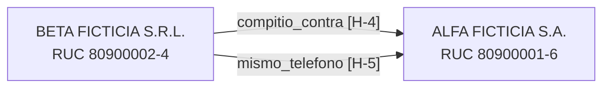

# Ficha de due diligence: Beta Ficticia

Caso 1 · creado 2026-10-24T00:05:24+00:00 · generado 2026-10-24T00:05:25+00:00 · modo mock · criterio ejemplo-0.1 (SHA-256 251e79b1eb3d…)

> Documento interno de trabajo. Solo afirma lo que dice cada fuente, con la etapa de cada caso judicial. El semáforo es una sugerencia; la conclusión la firma una persona. El proveedor debe poder responder antes de una decisión que lo afecte.

> ⚠ CONTIENE DATOS FICTICIOS (modo mock). No usar para ninguna decisión.

> ⚠ El criterio de semáforo es el EJEMPLO del documento de diseño: la UNI debe reemplazarlo antes de usar el sistema.

## Semáforo sugerido

**Color sugerido: ROJO** · puntaje P = 2 (color por puntaje: amarillo; reglas duras activadas: 2)

| Hallazgo | Tipo | Regla / categoría | Dato | Aporte |
|---|---|---|---|---|
| [H-2](mock://dncp/suppliers/80900002-4) | Regla dura | inhabilitacion_dncp_vigente | Inhabilitación vigente en la DNCP (2026-03-01 a 2027-03-01) | — |
| [H-6](demo://sanciones/demo-001) | Regla dura | sancion_confirmada_por_identificador | Figura en lista de sanciones (DEMO-FICTICIO): Inhabilitación ficticia de prueba | — |
| [H-5](mock://dncp/suppliers/80900001-6) | hecho | llave_compartida_competidor | Mismo teléfono (21000111) que ALFA FICTICIA S.A., competidora en los mismos procesos | 2 × 1 = 2 |

## Resumen (cada línea cita su hallazgo)

BETA FICTICIA S.R.L. (RUC 80900002-4) figura como proveedora en la DNCP [H-1].
Tiene una inhabilitación vigente por fechas en la DNCP [H-2].
Compitió contra ALFA FICTICIA S.A. [H-4] y comparte con ella un teléfono [H-5].
Figura en la lista de sanciones de demo con su RUC [H-6].
La búsqueda de prensa no devolvió resultados [C-16].

## Entidades resueltas

| Id | Razón social | Tipo | País | Identificadores | Dominio | Rol |
|---|---|---|---|---|---|---|
| E-1 | BETA FICTICIA S.R.L. | S.R.L. | PY | RUC: 80900002-4 |  | investigada |
| E-2 | ALFA FICTICIA S.A. | S.A. | PY | RUC: 80900001-6 |  | competidor |

## Hallazgos

### BETA FICTICIA S.R.L. (RUC: 80900002-4)

| Id | Dato | Tipo | Estado | Conf. | Etapa | Fuente | Fecha (UTC) | Captura |
|---|---|---|---|---|---|---|---|---|
| [H-1](mock://dncp/suppliers/80900002-4) | Proveedor DNCP BETA FICTICIA S.R.L. (RUC 80900002-4) | hecho | encontrado | A |  | DNCP API v3 (mock) | 2026-10-24T00:05:25+00:00 | casos/caso-1/capturas/0001-mock-dncp-suppliers-80900002-4.html (sha256 2c0cfde19532…) |
| [H-2](mock://dncp/suppliers/80900002-4) | Inhabilitación vigente en la DNCP (2026-03-01 a 2027-03-01) | hecho | encontrado | A |  | DNCP API v3 (mock) | 2026-10-24T00:05:25+00:00 | casos/caso-1/capturas/0002-mock-dncp-suppliers-80900002-4.html (sha256 2c0cfde19532…) |
| [H-3](mock://dncp/search/processes?awards.suppliers.id=80900002-4&page=1&items_per_page=10) | 1 proceso(s) adjudicado(s) en la DNCP | contexto | encontrado | A |  | DNCP API v3 (mock) | 2026-10-24T00:05:25+00:00 | casos/caso-1/capturas/0003-mock-dncp-search-processes-awards-suppliers-id-80900002-4-page-1-items-per-page-.html (sha256 2fa0290ae4bc…) |
| [H-4](mock://dncp/ocds/record/ocds-mock-1002) | Compitió contra ALFA FICTICIA S.A. en ocds-mock-1002 (3 oferentes) | contexto | encontrado | A |  | DNCP API v3 (mock) | 2026-10-24T00:05:25+00:00 | casos/caso-1/capturas/0004-mock-dncp-ocds-record-ocds-mock-1002.html (sha256 eaf79e94b29a…) |
| [H-5](mock://dncp/suppliers/80900001-6) | Mismo teléfono (21000111) que ALFA FICTICIA S.A., competidora en los mismos procesos | hecho | encontrado | A |  | DNCP API v3 (mock) | 2026-10-24T00:05:25+00:00 | casos/caso-1/capturas/0005-mock-dncp-suppliers-80900001-6.html (sha256 0ac683a58ccc…) |
| [H-6](demo://sanciones/demo-001) | Figura en lista de sanciones (DEMO-FICTICIO): Inhabilitación ficticia de prueba | hecho | encontrado | B |  | DEMO (ficticio) (mock) | 2026-10-24T00:05:25+00:00 | casos/caso-1/capturas/0006-demo-sanciones-demo-001.html (sha256 b1333adcaafb…) |

## Consultas sin resultado (el «no encontrado» también es un resultado)

| Id | Fuente | Consulta exacta | Fecha (UTC) |
|---|---|---|---|
| [C-1](mock://dncp/search/suppliers?name=Beta Ficticia S.R.L.&page=1&items_per_page=10) | DNCP API v3 (OCDS) | search/suppliers name='Beta Ficticia S.R.L.' ruc=None categoria=None sancion=None p1 | 2026-10-24T00:05:25+00:00 |
| [C-5](mock://dncp/search/suppliers?name=Beta Ficticia S.R.L&page=1&items_per_page=10) | DNCP API v3 (OCDS) | search/suppliers name='Beta Ficticia S.R.L' ruc=None categoria=None sancion=None p1 | 2026-10-24T00:05:25+00:00 |
| C-16 | Búsqueda web | "Beta Ficticia" site:abc.com.py | 2026-10-24T00:05:25+00:00 |

## Brechas de información (no se pudo consultar)

| Ref. | Fuente | Consulta | Motivo |
|---|---|---|---|
| C-14 | Poder Judicial – consulta de expedientes | Expedientes de BETA FICTICIA S.R.L. | Sin API conocida. Navegador solo si los términos de uso lo permiten. |
| C-15 | DNIT – Listado de RUC con equivalencias | dnit ruc='80900002-4' nombre=None | Modo mock: el listado DNIT no tiene datos ficticios |

## Vínculos y llaves compartidas

| Desde | Vínculo | Hacia | Respaldo |
|---|---|---|---|
| E-1 BETA FICTICIA S.R.L. | compitio_contra | E-2 ALFA FICTICIA S.A. | [H-4](mock://dncp/ocds/record/ocds-mock-1002) |
| E-1 BETA FICTICIA S.R.L. | mismo_telefono | E-2 ALFA FICTICIA S.A. | [H-5](mock://dncp/suppliers/80900001-6) |

| Llave | Valor | Entidades |
|---|---|---|
| teléfono | 21000111 | E-1 BETA FICTICIA S.R.L.; E-2 ALFA FICTICIA S.A. |

Una llave compartida es un dato a explicar; no implica irregularidad ni parentesco.

## Tareas de verificación

- Ninguna.

## Qué cambiaría el resultado

- El rojo viene de una regla dura: solo cambia si el hecho que la activa se desmiente en la fuente.
- Brecha: Poder Judicial – consulta de expedientes no fue accesible (Expedientes de BETA FICTICIA S.R.L.); un resultado ahí podría cambiar el color.
- Brecha: DNIT – Listado de RUC con equivalencias no fue accesible (dnit ruc='80900002-4' nombre=None); un resultado ahí podría cambiar el color.

## Calidad de la evidencia

- Hallazgos con URL, fecha y captura: 6/6
- Consultas registradas: 16 (3 sin resultado)
- Hallazgos por tipo: hecho 4, posible_alerta 0, contexto 2

## Revisión humana

- Revisado por: ____________________
- Fecha: ____________________
- Conclusión (verde / amarillo / rojo) y motivo: ____________________
- ¿Se dio al proveedor la oportunidad de responder? ____
